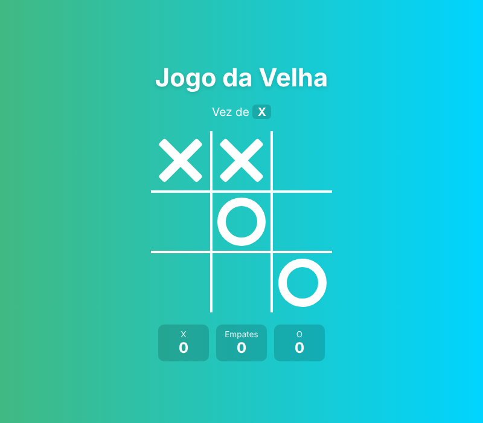

# Jogo da Velha

[](https://github.com/almircs/Jogo-da-Velha/actions/workflows/ci.yml)

Jogo da velha para dois jogadores no mesmo computador, feito com HTML, CSS e JavaScript puro.

**[▶ Jogar agora](https://almircs.github.io/Jogo-da-Velha/)**



## Funcionalidades

- Detecção de vitória nas 8 combinações possíveis e de empate
- Destaque da jogada vencedora
- Indicador de quem joga e prévia da jogada ao passar o mouse
- Placar de vitórias e empates durante a sessão
- Jogável pelo teclado (`Tab` para escolher a casa, `Enter` para jogar)
- Layout responsivo, do celular ao desktop

## Como funciona

O tabuleiro tem 9 botões. A cada jogada, o script adiciona a classe `x` ou `circle` na casa e compara o tabuleiro com a lista de combinações vencedoras usando `some` e `every`. Os símbolos são desenhados só com CSS, com pseudo-elementos `::before` e `::after`.

## Rodar localmente

```bash
git clone https://github.com/almircs/Jogo-da-Velha.git
```

Depois é só abrir o `index.html` no navegador.

## Tecnologias

HTML5 · CSS3 (Grid, pseudo-elementos, variáveis) · JavaScript

## Licença

[MIT](LICENSE)
